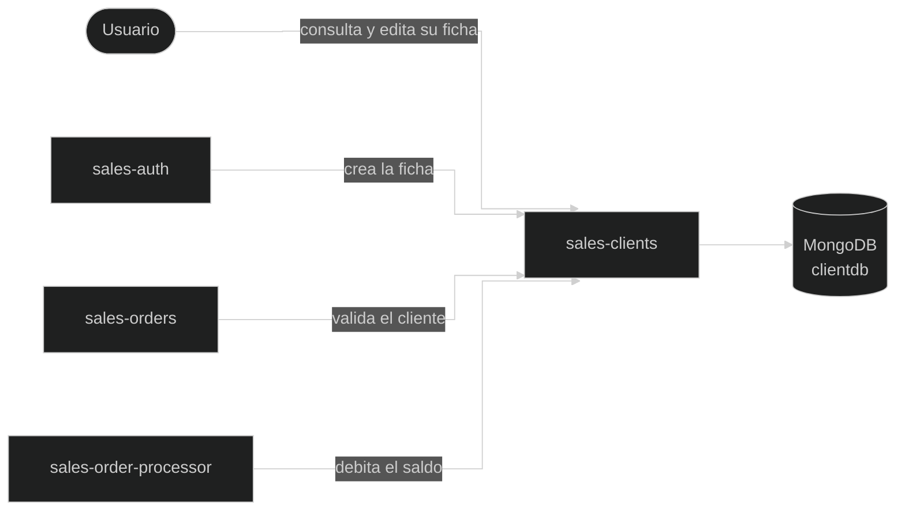

# sales-clients

Microservicio de **clientes** de Benito Ventas. Guarda la ficha de cada cliente (sus datos de negocio y su saldo), permite que el cliente consulte y edite la suya, y que el administrador gestione todas.

---

## Arquitectura interna

```
resource/    → Endpoints HTTP
service/     → Lógica de negocio (incluye el chequeo de acceso y el saldo)
repository/  → Acceso a MongoDB (Panache)
entity/      → Documento de Mongo (Client)
dto/         → Objetos de entrada y salida
exception/   → Excepciones de negocio
mapper/
  exceptionMapper/ → Convierten excepciones en respuestas HTTP
helper/      → ErrorResponseBuilder
filter/      → MtlsGuardFilter: exige certificado de cliente a admin y servicios
```



### La ficha del cliente

| Campo | Descripción |
|---|---|
| `id` | Id de la ficha |
| `userId` | Id del usuario dueño de la ficha, en `sales-auth` (referencia externa, `String`) |
| `name`, `lastName`, `phone`, `address` | Datos del cliente |
| `balance` | Saldo disponible para comprar. Empieza en `0` |
| `processedOrders` | IDs de las órdenes que ya se cobraron a esta ficha. Es la llave de idempotencia del débito |
| `status`, `createdBy`, `createdAt`, `updatedBy`, `updatedAt` | Borrado lógico y auditoría |

`username` y `email` no se guardan aquí: pertenecen al usuario, en `sales-auth`.

---

## Configuración

| Propiedad | Valor / descripción |
|---|---|
| `quarkus.http.ssl-port` | `8081` en desarrollo, `8443` en Docker. Solo https (TLS/mTLS: ver el [README principal](../README.md#tls-y-mtls)) |
| `quarkus.http.auth.proactive` | `false` |
| `quarkus.mongodb.database` | `clientdb` |
| `mp.jwt.verify.issuer` | `https://benito-ventas.app` |
| `mp.jwt.verify.publickey.location` | En desarrollo: `src/main/resources/publicKey.pem`. En Docker: `/run/secrets/jwt_public_key` |
| `quarkus.swagger-ui.always-include` | Swagger UI disponible también en Docker, en `/q/swagger-ui` |

---

## Endpoints

Ruta base: `/api/v1/client`

| Método | Ruta | Acceso | Descripción | Respuesta |
|---|---|---|---|---|
| `GET` | `/api/v1/client` | `admin` | Lista los clientes activos, paginados, por nombre y apellido | `200` |
| `GET` | `/api/v1/client/{id}` | `admin`, `client` (solo la suya) | Obtiene una ficha | `200` |
| `POST` | `/api/v1/client` | `aService` (solo `sales-auth`) | Crea la ficha de un usuario recién registrado | `201` + `Location` |
| `PUT` | `/api/v1/client/{id}` | `admin`, `client` (solo la suya) | Actualiza los datos editables | `200` |
| `DELETE` | `/api/v1/client/{id}` | `admin` | Desactiva una ficha | `204` |
| `POST` | `/api/v1/client/{id}/balance/debit` | `admin`, `paymentService` (con certificado) | Descuenta saldo (lo usa `sales-order-processor` al cobrar una orden) | `200` |
| `POST` | `/api/v1/client/{id}/balance/credit` | `admin` | Recarga saldo | `200` |

### `POST /api/v1/client` (lo llama `sales-auth`)

```json
{
  "userId": "6ae17c914cdbb65e4a90a72a",
  "name": "Juan",
  "lastName": "Pérez",
  "email": "juan.perez@email.com"
}
```

| Campo | Regla |
|---|---|
| `userId` | Obligatorio |
| `name`, `lastName` | Obligatorios, máximo 50 caracteres |
| `email` | Obligatorio, formato válido, máximo 100 caracteres |
| `phone` | Opcional, máximo 20 caracteres |
| `address` | Opcional, máximo 200 caracteres |

### `PUT /api/v1/client/{id}`

```json
{
  "name": "Juan",
  "lastName": "Pérez",
  "phone": "809-555-1234",
  "address": "Calle Principal #10, Santo Domingo"
}
```

Mismas reglas que arriba para estos campos. No incluye `balance`: el saldo solo cambia con `debit` y `credit`.

### `debit` y `credit`

```json
{ "amount": 99.99, "orderId": "6ae39763a243151510291111" }
```

| Campo | Regla |
|---|---|
| `amount` | Obligatorio, mayor que 0 |
| `orderId` | Opcional, solo en `debit`. Lo envía el procesador: si esa orden ya se cobró, no se vuelve a cobrar |

### Cómo funciona el débito

El débito es **una sola operación atómica** en MongoDB (`findOneAndUpdate`): la condición y el cambio se hacen juntos, así nadie puede meterse en medio.

- **Condición:** la ficha está activa, tiene saldo suficiente y (si viene `orderId`) esa orden **no** está en `processedOrders`.
- **Cambio:** resta el monto con `$inc`, guarda la auditoría y agrega el `orderId` a `processedOrders`.
- Devuelve la ficha **después** del cambio, con el balance real.

Si la operación no encuentra la ficha (porque otro cambio llegó primero), el servicio vuelve a leerla y lo intenta otra vez, hasta 3 veces:

- Si la orden ya está en `processedOrders` → responde `200` sin cobrar otra vez (**idempotencia**).
- Si ya no alcanza el saldo → `422`.
- Si tras 3 intentos sigue sin poder → `409`. En ese caso es seguro que **no** se cobró.

El crédito funciona igual (sin la condición de saldo ni el `orderId`). Editar y desactivar una ficha usan `$set` solo con sus propios campos, así nunca pisan el balance.

### Respuesta (`ClientResponseDTO`)

```json
{
  "id": "6ae17c9146fe9c4fdff515bc",
  "userId": "6ae17c914cdbb65e4a90a72a",
  "name": "Juan",
  "lastName": "Pérez",
  "phone": "809-555-1234",
  "address": "Calle Principal #10, Santo Domingo",
  "balance": 100.00
}
```

---

## Errores

| Situación | Status |
|---|---|
| Id con formato inválido / datos inválidos | `400` |
| Sin token / token inválido | `401` |
| Rol no permitido, o un cliente intenta acceder a una ficha ajena | `403` |
| Ficha inexistente o desactivada | `404` |
| Saldo insuficiente al descontar | `422` |
| La ficha cambió 3 veces seguidas mientras se intentaba descontar (conflicto) | `409` |
| Error inesperado | `500` |

---

## Decisiones de diseño

- **Solo `sales-auth` crea fichas**, usando un token de servicio con rol `aService`. Así toda ficha tiene un usuario detrás.


- **El chequeo de "solo lo suyo" está en el service**: compara el `userId` guardado en la ficha con el claim `userId` del token. El resource no puede hacerlo porque solo tiene el id de la ruta, que es el de la ficha, no el del usuario.


- **Solo el admin y `paymentService` debitan**: el cliente ya no puede descontarse saldo directamente; el saldo solo baja por una orden o por una acción del admin (menor privilegio). `paymentService` puede cobrar a cualquier ficha porque la validación de que la ficha es del usuario ya se hizo en orders, al crear la orden.


- **Débito atómico e idempotente**: evita la actualización perdida (un crédito y un débito simultáneos ya no se pisan) y el cobro doble (un mensaje repetido o un reintento con el mismo `orderId` no cobra otra vez).


- **Conflicto → 409**: tras 3 intentos fallidos el cliente recibe un error claro, con la certeza de que no se cobró.


- **El saldo tiene endpoints propios** (`debit` y `credit`) en lugar de editarse con el `PUT`. Así un cliente no puede asignarse saldo a sí mismo, y solo el admin puede recargarlo.


- **Saldo insuficiente → 422**: la petición es correcta, pero rompe una regla de negocio.


- **Un DTO por operación**: `ClientRequestDTO` para crear y `ClientUpdateRequestDTO` para editar.