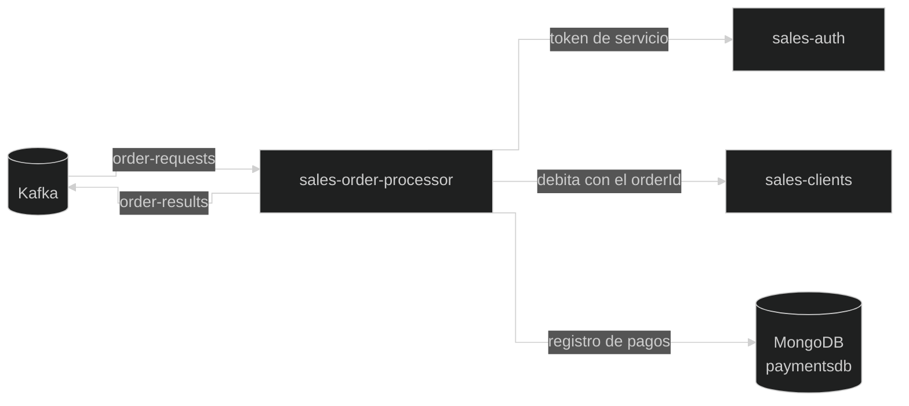

# sales-order-processor

Microservicio que **cobra las órdenes** de Benito Ventas. Escucha en Kafka las órdenes que publica `sales-orders`, le debita el total al cliente en `sales-clients` y publica el resultado (`COMPLETED` o `REJECTED`) para que `sales-orders` actualice la orden.

No tiene endpoints de negocio: todo su trabajo ocurre en segundo plano, a partir de los mensajes de Kafka.

---

## Por qué es un servicio aparte

Antes, `sales-orders` publicaba la orden y la consumía él mismo. Funcionaba, pero la API y el procesamiento vivían en el mismo servicio:

- No se podían **escalar por separado**: más consumidores obligaban a levantar más instancias de toda la API.
- Si el procesamiento se volvía pesado, **afectaba a la API** que atiende a los usuarios.
- Un cambio en el cobro obligaba a **redesplegar también la API**.

Ahora `sales-orders` solo recibe órdenes y muestra su estado, y este servicio se encarga del cobro.

---

## Arquitectura interna

```
consumer/    → OrderProcessor: escucha el topic de órdenes y llama a OrderProcessorService
service/
  OrderProcessorService → Cobra la orden y publica el resultado
  ServiceTokenProvider  → Pide a sales-auth el token de servicio para cobrar
repository/  → OrdersPaymentsRepository: registro de pagos en MongoDB (Panache)
entity/      → OrdersPayments (pago de una orden) y el enum OrderStatus
dto/         → Mensajes de Kafka y objetos para hablar con clients y auth
restClient/  → Clientes HTTP hacia sales-clients y sales-auth
exception/   → Excepciones de los otros servicios
```



### El registro de pago (`OrdersPayments`, colección `payments`)

| Campo | Descripción |
|---|---|
| `orderId` | Orden que se cobra. Tiene **índice único**: no puede haber dos registros para la misma orden |
| `clientId`, `amount` | A quién se cobra y cuánto |
| `status` | `PROCESSING` (el cobro empezó), `COMPLETED` o `REJECTED` |
| `rejectionReason` | Motivo del rechazo (solo si es `REJECTED`) |
| `createdAt`, `updatedAt` | Auditoría |

El índice único se crea al arrancar el servicio.

Sirve para saber si una orden **ya se procesó**, y así no cobrarla dos veces si el mismo mensaje llega otra vez.

---

## Cómo se cobra una orden

1. `OrderProcessor` recibe el mensaje con `clientId`, `orderId` y el total de la orden.
2. **Busca si la orden ya se procesó.** Si ya tiene un resultado guardado (`COMPLETED` o `REJECTED`), **no vuelve a cobrar**: solo publica otra vez ese resultado, por si el mensaje anterior se perdió. Si no existe, guarda el registro en `PROCESSING`.
3. **Pide un token de servicio** a `sales-auth` (rol `paymentService`).
4. **Debita el total** en `sales-clients`, enviando el `orderId`.
5. Guarda el resultado y lo **publica** en el topic de resultados.

| Resultado del débito | Qué pasa |
|---|---|
| Se cobró | Guarda y publica `COMPLETED` |
| Saldo insuficiente (`422`), ficha inexistente (`404`), acceso denegado (`403`) o conflicto (`409`) | Guarda y publica `REJECTED` con el motivo |
| `sales-clients` no respondió (caído o timeout), incluso tras 2 reintentos | **No publica nada.** No se sabe si el cobro se aplicó, así que no se puede decir `REJECTED`. La excepción sube, el mensaje va a la **dead letter queue** y el registro queda en `PROCESSING` |

Un registro en `PROCESSING` no bloquea nada: si el mensaje se reprocesa, el procesador vuelve a intentar el débito, y la llave de idempotencia de clients evita cobrar dos veces.

---

## Idempotencia: una orden nunca se cobra dos veces

Kafka entrega los mensajes **al menos una vez** (*at-least-once*): si el servicio se cae después de cobrar pero antes de confirmar el mensaje, ese mismo mensaje llega otra vez. Hay dos protecciones:

1. **En este servicio:** el registro de `OrdersPayments` (con índice único en `orderId`). Si la orden ya tiene un resultado, no se vuelve a cobrar.
2. **En `sales-clients`:** el `orderId` viaja con el débito como **llave de idempotencia**. Clients guarda las órdenes que ya cobró a cada cliente, y lo comprueba **en la misma operación atómica** que resta el saldo. Si le llega el mismo `orderId` otra vez, no cobra y responde como un débito exitoso.

Gracias a la segunda, reintentar un débito es seguro, incluso después de un timeout o al reprocesar un mensaje de la dead letter queue. Por eso el REST client de clients **sí reintenta** el débito (2 veces, cada 500 ms) cuando no hay respuesta.

---

## Configuración

| Propiedad | Valor / descripción |
|---|---|
| `quarkus.http.port` | `8085` en desarrollo. No tiene endpoints de negocio: solo `/q/health`. En Docker no se publica ningún puerto |
| `quarkus.mongodb.database` | `paymentsdb` |
| `quarkus.rest-client.client-api.url` | En desarrollo: `https://localhost:8081`. En Docker: `https://sales-clients:8443` |
| `quarkus.rest-client.auth-api.url` | En desarrollo: `https://localhost:8083`. En Docker: `https://sales-auth:8443` |
| `quarkus.rest-client.*.tls-configuration-name` | `internal`: presenta el certificado del procesador (`order-processor.crt`) (`CN=sales-order-processor`) a clients y auth |
| `quarkus.rest-client.connect-timeout` / `read-timeout` | `2000` / `5000` ms |
| `kafka.bootstrap.servers` | En desarrollo: `localhost:9092`. En Docker: `kafka:29092` |
| `mp.messaging.incoming.orders-in.*` | Topic `order-requests`, grupo `orders-processor`, `concurrency=3` (un consumidor por partición), `auto.offset.reset=earliest`, `failure-strategy=dead-letter-queue` |
| `mp.messaging.outgoing.order-results-out.*` | Topic `order-results`, que consume `sales-orders` |
| `kafka.security.protocol` / `kafka.ssl.*` | `SSL` con `order-processor.pem` (certificado + llave) y `ca.crt`: mTLS hacia Kafka. En desarrollo, `PLAINTEXT` |
| `processor.service.secret` | Secreto para pedir el token de servicio (en Docker: `PROCESSOR_SERVICE_SECRET`) |

---

## Decisiones de diseño

- **Servicio separado del API de órdenes:** la API y el cobro escalan, fallan y se despliegan por separado.
- **Llave de idempotencia con el `orderId`:** un mensaje repetido o un reintento nunca cobra dos veces.
- **Con un timeout no se rechaza la orden:** el resultado es incierto; decir `REJECTED` podría ser falso si el cobro sí se aplicó. El mensaje queda en la dead letter queue para reprocesarlo con seguridad.
- **El resultado viaja por Kafka, no por HTTP:** `sales-orders` no necesita estar disponible en el momento del cobro; el resultado espera en el topic.
- **La key sigue siendo el `clientId`:** las órdenes de un mismo cliente se cobran en orden, una detrás de otra.
- **3 consumidores para 3 particiones:** más rendimiento sin perder el orden por cliente.
- **El mensaje trae el total:** el procesador no lee la base de orders ni llama a products; cada servicio solo toca su propia base.